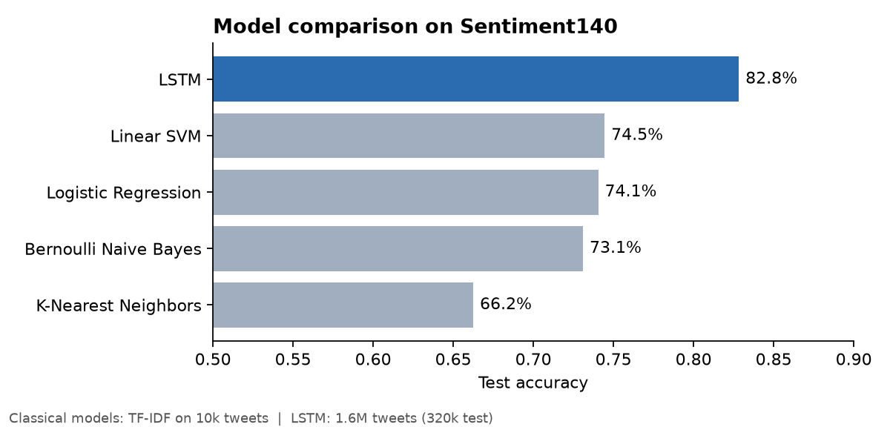
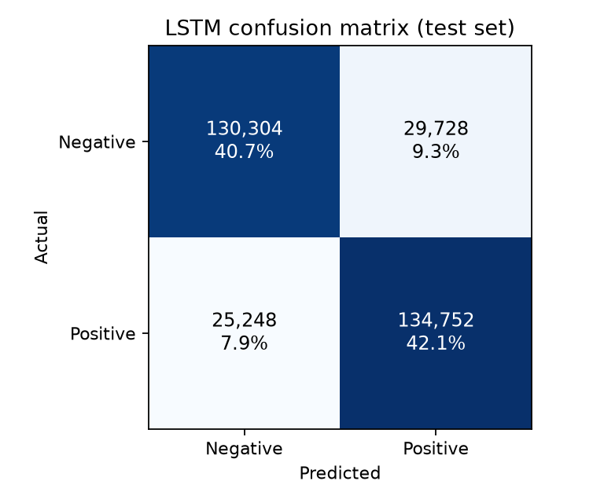
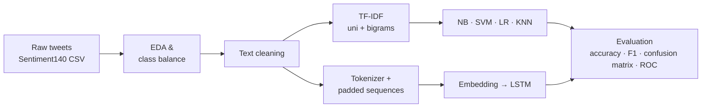
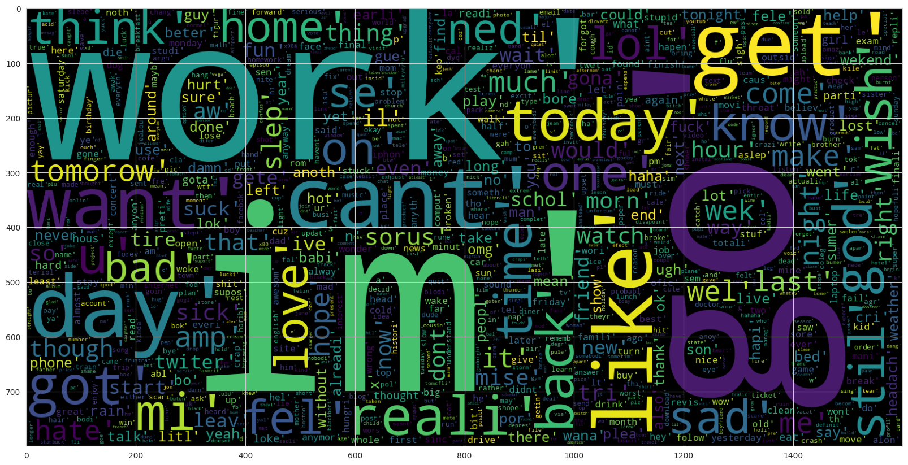
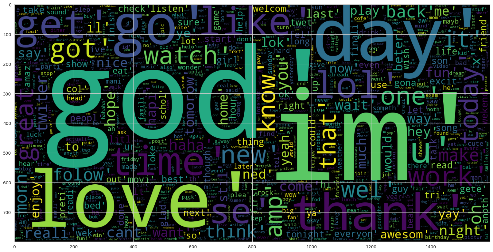

# Twitter Sentiment Analysis

[](https://github.com/muhammadsohail613/-Twitter-Sentiment-Analysis/actions/workflows/ci.yml)


[](LICENSE)

This project classifies tweets as **positive** or **negative**, using the 1.6-million-tweet
[Sentiment140](http://help.sentiment140.com/for-students) dataset. It compares four classical
machine-learning models trained on TF-IDF features with a deep-learning **LSTM**. The project is
also packaged as a tested Python module, with a command line for training and prediction.

**Highlights**

- An end-to-end NLP pipeline: data loading, EDA, text normalization, feature engineering,
  training, evaluation, and inference.
- Five model families compared: Naive Bayes, Linear SVM, Logistic Regression, KNN, and LSTM.
- The best model, an **LSTM, reaches 82.8% accuracy** on a 320,000-tweet held-out test set.
- Production-minded code: cleaning lives *inside* the scikit-learn pipeline, so a saved model
  takes raw tweets. The repo also has unit and end-to-end tests, linting, and GitHub Actions CI.

---

## Results

<p align="center">
  
</p>

| Model | Training data | Accuracy | Macro F1 |
|---|---|---:|---:|
| **LSTM** (128-d embedding, 128 units) | 1.28M tweets | **82.8%** | **0.83** |
| Linear SVM | 8k tweets | 74.5% | 0.74 |
| Logistic Regression | 8k tweets | 74.1% | 0.74 |
| Bernoulli Naive Bayes | 8k tweets | 73.1% | 0.73 |
| K-Nearest Neighbors (k=5) | 8k tweets | 66.3% | 0.66 |

All numbers come from the experiments in
[`notebooks/Sentiment_Analysis.ipynb`](notebooks/Sentiment_Analysis.ipynb), with an 80/20
train/test split.

<p align="center">
  
</p>

**Key takeaways**

- **Sequence models win.** The LSTM reads word order and context ("not good" vs. "good"),
  which a bag-of-n-grams representation only approximates. Combined with far more training
  data, this gives about an 8-point gain over the best linear model.
- **Linear models are strong, cheap baselines.** SVM and Logistic Regression score within 0.4
  points of each other, train in seconds, and are easy to interpret.
- **KNN is a poor fit for sparse text.** Distance measures break down in a 60k-dimensional
  TF-IDF space.
- The LSTM's errors are balanced (9.3% false positives vs. 7.9% false negatives), so it is
  not biased toward either class.

> **Note on fairness of the comparison:** the classical models were trained on a 10,000-tweet
> sample to keep the experiments fast. The LSTM used the full dataset. To compare the classical
> models at scale, run `sentiment-train` (below) with `--sample-size 0`.

---

## Pipeline



**Text cleaning** (`src/sentiment/preprocessing.py`):

1. Decode HTML entities (`&quot;` → `"`) and lowercase the text.
2. Remove URLs and `@mentions`, and keep the word from each hashtag (`#happy` → `happy`).
3. Expand negations (`don't` → `do not`) and drop digits and punctuation.
4. Shorten elongated words (`soooo` → `soo`) while keeping real double letters (`good`).
5. Remove stop words, **but keep negations** such as *not*, *no*, and *never*, because they
   flip sentiment.
6. Apply Porter stemming.

### What the model sees

| Negative tweets | Positive tweets |
|---|---|
|  |  |

---

## Quick start

```bash
git clone https://github.com/muhammadsohail613/-Twitter-Sentiment-Analysis.git
cd -Twitter-Sentiment-Analysis
python -m venv .venv && source .venv/bin/activate
pip install -e ".[dev]"

# 1. Get the data (1.6M tweets, ~230 MB)
./scripts/download_data.sh

# 2. Train and compare models (writes reports/ and models/)
sentiment-train --data data/training.1600000.processed.noemoticon.csv --sample-size 200000

# 3. Classify new text with the best saved model
sentiment-predict "I love this new phone!" "Worst customer service ever"
# Example output:
# Positive  | I love this new phone!
# Negative  | Worst customer service ever
```

Training writes `reports/metrics.csv`, `reports/metrics.json`, a confusion matrix for each
model, and a comparison chart. It also saves the best pipeline to
`models/sentiment_model.joblib`.

You can also use it from Python:

```python
import joblib
model = joblib.load("models/sentiment_model.joblib")
model.predict(["this is not good at all", "absolutely loved it"])  # 0 = negative, 1 = positive
```

To re-run the exploratory notebook with the LSTM, install the extras with
`pip install -e ".[notebook]"` and open `notebooks/Sentiment_Analysis.ipynb`.

### Tests

```bash
ruff check .   # lint
pytest -q      # 20 unit + end-to-end tests, no dataset download needed
```

---

## Project structure

```
├── src/sentiment/
│   ├── preprocessing.py   # tweet cleaning + scikit-learn transformer
│   ├── data.py            # Sentiment140 loading, label mapping, balanced sampling
│   ├── models.py          # model registry -> raw-text pipelines
│   ├── train.py           # CLI: train, evaluate, plot, save best model
│   └── predict.py         # CLI: classify new tweets
├── tests/                 # pytest suite (runs on synthetic data)
├── notebooks/             # original EDA + modelling notebook, including the LSTM
├── docs/                  # project report and flowchart
├── assets/                # figures used in this README
├── scripts/download_data.sh
└── .github/workflows/ci.yml
```

## Dataset

**Sentiment140** (Go, Bhayani & Huang, Stanford, 2009) contains 1,600,000 English tweets from
April to June 2009. The tweets were labeled automatically by *distant supervision*: tweets with
positive emoticons such as `:)` were labeled positive, and tweets with negative emoticons such
as `:(` were labeled negative. The emoticons were then removed from the text. The training set
is perfectly balanced (800k / 800k) and contains only **positive** and **negative** labels.

**Limitations.** The labels are noisy because emoticons only approximate sentiment. Sarcasm is
common, and 2009-era Twitter language differs from today's. Models trained here should be
validated before being used on current social media data.

## Future work

- Fine-tune a transformer (e.g. DistilBERT or RoBERTa-base trained on tweets) for an expected
  85% or higher accuracy.
- Tune hyperparameters with cross-validation for the linear models at full data scale.
- Serve the model through a small FastAPI endpoint or a Streamlit demo.

## Author

[@muhammadsohail613](https://github.com/muhammadsohail613)

If you found this project useful, consider giving it a ⭐.

## License

Released under the [MIT License](LICENSE).
